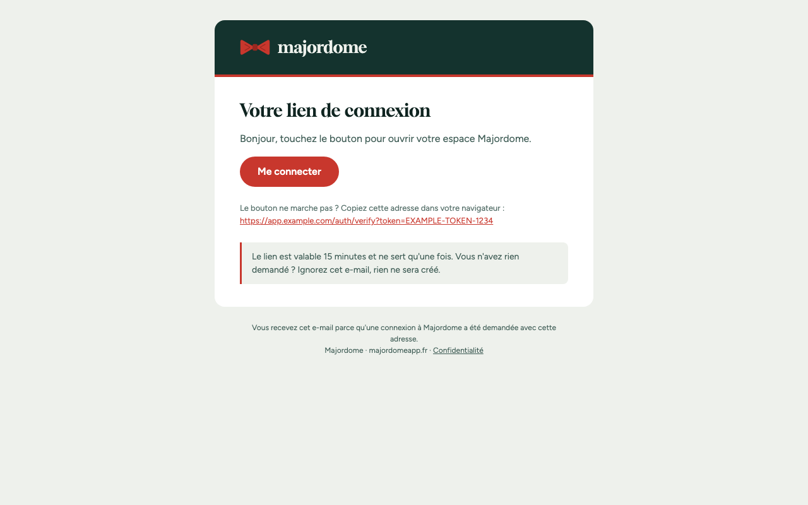
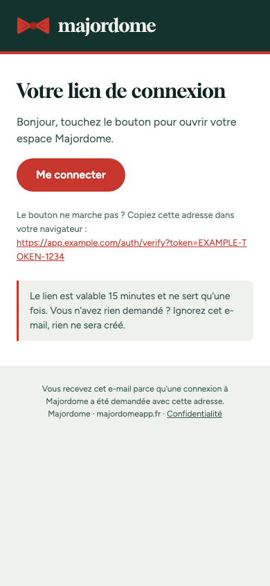
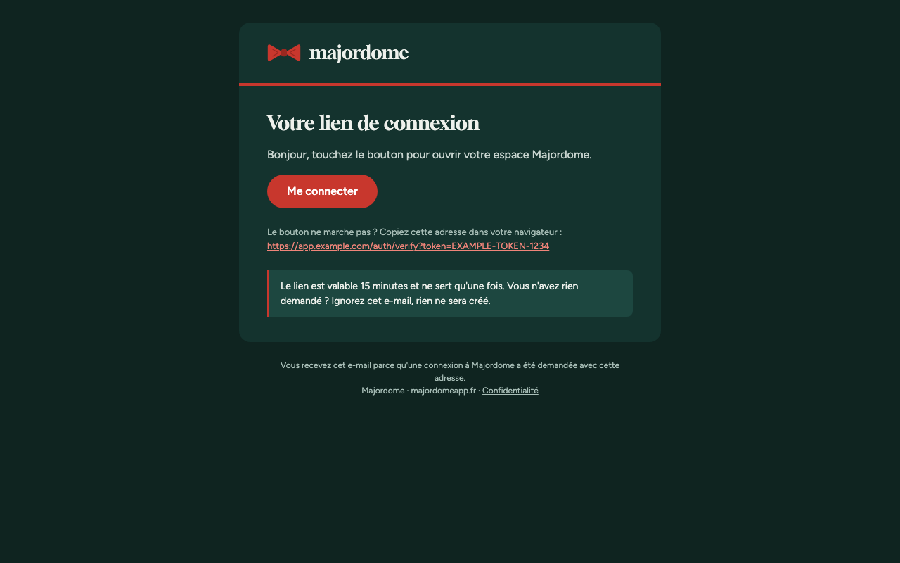
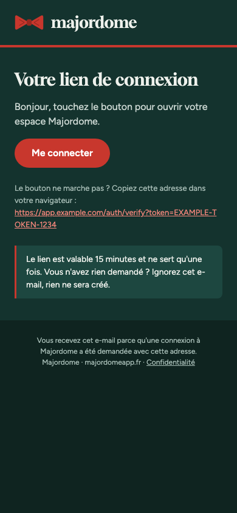
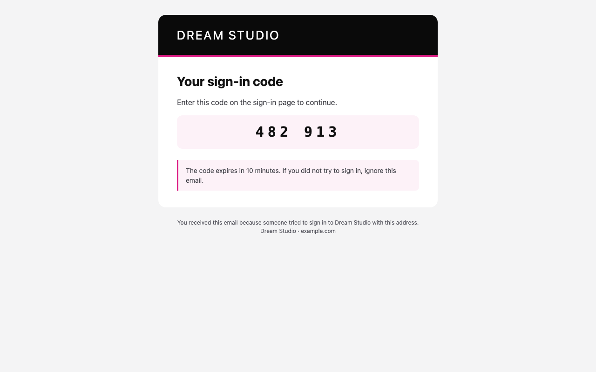
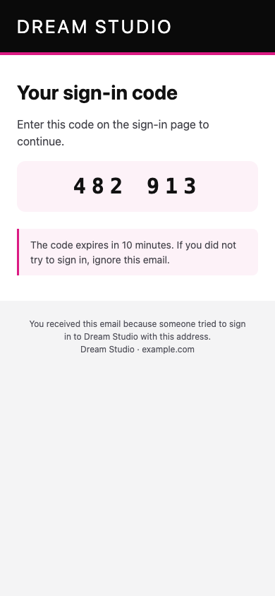
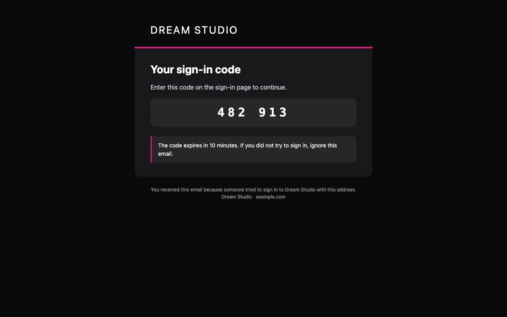
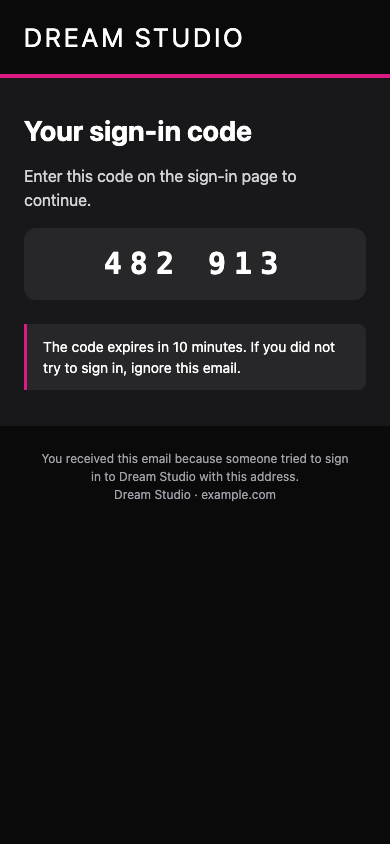

# 5. Screens

mail-kit's screens are the mails themselves. The mockups are real mail html, written by
`images/src/build-mockups.mjs` from `images/src/themes.json`, and rendered by
`images/src/render-mockups.sh` in headless Chromium, in light and dark, at 1280 × 800 and
390 × 844. They do not link a shared `mockup.css`: a mail can carry no external
stylesheet, so each file holds its own inline styles, as the real output will (F4.1).
Rebuild: `node spec/images/src/build-mockups.mjs && spec/images/src/render-mockups.sh`.

| Screen | Access | Content and actions | Features |
| --- | --- | --- | --- |
| Majordome magic-link mail | the recipient's mail client | heading, paragraph, button « Me connecter », fallback link, note, footer | F2, F4, F7 |
| Dream Studio sign-in code mail | the recipient's mail client | heading, paragraph, code, note, footer | F2, F4, F7 |
| Preview gallery `preview/index.html` | Claude and the owner, local file | links to every theme × sample, html, txt and PNG | F5 |

## 5.1 The layout

Every mail has the same frame, top to bottom:

1. **Canvas**: the theme's `canvas`, 32 px above and below the card on wide screens, none
   on phones.
2. **Banner**: the theme's `brand`, 28 × 40 px padding (22 × 24 on phones), the logo
   (when set) and the wordmark in the display font, 26 px. Top corners rounded 16 px on
   wide screens, square on phones.
3. **Accent rule**: 4 px of `accent`.
4. **Card**: `card` background, 36 × 40 px padding (24 px sides on phones), bottom corners
   rounded 16 px; the blocks in order.
5. **Footer**: centred, 12 px, `footerText`: the reason, then the legal line and the
   optional link.

Blocks: heading 28/34 px display font; paragraph 16/24 px `textSoft`; button 16 px
semibold, 14 × 28 px padding, `buttonRadius`; fallback link 13/20 px `muted` with the
address in `link`, broken anywhere; code 30 px monospace, 8 px letter spacing, centred in
a `subtle` box (smaller, set inline, for a code over 12 displayed characters: F4.7); note 14/21 px in a `subtle` box with a 3 px `accent` left border; divider
1 px `subtle` line with 24 px above and below.

## 5.2 Majordome: magic-link mail

The theme follows Majordome's site (`public/site.css`): livery banner, lacquer accent and
button pill, linen canvas, Gloock wordmark and heading, Figtree body, bow-tie logo. The
mockup loads the fonts from local files; in Gmail and Outlook, which ignore web fonts,
the heading falls back to Georgia and the body to the system sans-serif. In dark mode the
card turns livery and the text linen; the banner keeps its colours.

## 5.3 Dream Studio: sign-in code mail

The theme follows Dream Studio's mail-service: black banner, pink accent, system fonts,
a spaced uppercase wordmark and no logo (the wordmark-only case of the banner). It shows
the code block, which Majordome does not use.

## 5.4 States the images do not show

- **Outlook classic (Word engine)**: no rounded corners, the button drawn by VML with the
  same colours, the fallback stacks instead of web fonts, the card fixed at 600 px.
- **Gmail with forced dark mode** (Gmail apps invert colours themselves and ignore the
  media query): the banner and button keep their background colours; the result is
  checked in M2 (F8).
- **A client without the `<style>` block**: the light layout at 600 px, scaled down by the
  client on a phone.
